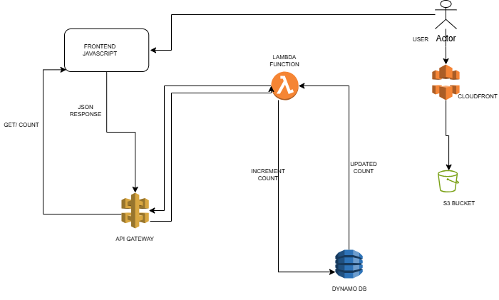

# AWS Cloud Resume Challenge

A cloud-hosted professional resume and portfolio built with **AWS, Terraform, Python, and GitHub Actions**. This project demonstrates static website hosting, serverless application development, infrastructure as code, and continuous integration.

## Live Website

**Portfolio:** https://d1rkmmc4pp4n09.cloudfront.net

## Architecture

The project uses AWS services to host a static resume website and provide a serverless visitor counter.

| Service | Purpose |
|---|---|
| Amazon S3 | Stores the HTML, CSS, and JavaScript frontend files. |
| Amazon CloudFront | Distributes the website over HTTPS. |
| Amazon API Gateway | Exposes the visitor-counter HTTP endpoint. |
| AWS Lambda | Executes the Python visitor-counter function. |
| Amazon DynamoDB | Stores and atomically increments the visitor count. |
| Terraform | Defines and manages AWS infrastructure. |
| GitHub Actions | Automatically validates project code and configuration. |

### Architecture Diagram

*Add your manually created architecture diagram here.*

Save the exported image as `docs/architecture.png`, then replace this note with:

```markdown

```

### Visitor Counter Flow

1. A visitor opens the resume website through CloudFront.
2. CloudFront serves the static frontend files stored in S3.
3. The frontend JavaScript requests the visitor count from API Gateway.
4. API Gateway invokes the Lambda function.
5. Lambda atomically increments the counter in DynamoDB.
6. The updated count is returned as JSON and displayed on the website.

**Note:** The counter tracks successful counter API requests, not unique individuals. Reloading the page can increment the counter again.

## Visitor Counter API

The visitor counter is exposed through an Amazon API Gateway HTTP API.

**Endpoint**

```text
GET https://zt5zhcxm3h.execute-api.eu-north-1.amazonaws.com/count
```

### Successful response

Example response:

```json
{
  "count": 42
}
```

The number `42` is illustrative. The actual value is returned by the API after the counter has been incremented.

### Error response

If the backend encounters an error, the Lambda function returns HTTP status `500` with a JSON error message.

```json
{
  "error": "Unable to retrieve visitor count"
}
```

The endpoint includes CORS headers to allow browser-based requests from the frontend.

## Repository Structure

```text
cloud-resume-challenge/
├── .github/
│   └── workflows/
│       └── ci.yml
├── backend/
│   ├── visitor_counter.py
│   └── visitor_counter.zip
├── frontend/
│   ├── index.html
│   ├── script.js
│   └── style.css
├── infrastructure/
│   ├── main.tf
│   └── .terraform.lock.hcl
├── .gitignore
└── README.md
```

## Technologies

- **Frontend:** HTML, CSS, JavaScript
- **Backend:** Python 3.12
- **Cloud platform:** Amazon Web Services (AWS)
- **Storage:** Amazon S3 and Amazon DynamoDB
- **Content delivery:** Amazon CloudFront
- **API:** Amazon API Gateway HTTP API
- **Compute:** AWS Lambda
- **Infrastructure as Code:** Terraform
- **Version control:** Git and GitHub
- **Continuous integration:** GitHub Actions

## Continuous Integration

The GitHub Actions workflow is located at `.github/workflows/ci.yml`.

It runs automatically on:

- Pushes to the `main` branch
- Pull requests targeting `main`

The workflow validates:

- Python syntax
- Required project files
- The configured visitor-counter API endpoint
- Terraform formatting
- Terraform initialization without configuring a remote backend
- Terraform configuration validity

The workflow performs **continuous integration and validation only**. Automated deployment to AWS through GitHub Actions is a future improvement.

## Deployment and Validation

### Prerequisites

Install or configure the following tools:

- AWS CLI
- Terraform 1.13.0
- Python 3.12
- Git

You also need an AWS identity with the required permissions for the resources and operations you intend to manage.

### 1. Validate the Python backend

From the repository root, run:

```bash
python -m py_compile backend/visitor_counter.py
```

This checks Python syntax. It does not invoke the Lambda function or verify connectivity to DynamoDB.

### 2. Validate Terraform

Move into the infrastructure directory:

```bash
cd infrastructure
```

Format-check the configuration:

```bash
terraform fmt -check -recursive
```

Initialize Terraform without configuring a remote backend:

```bash
terraform init -backend=false -input=false
```

Validate the configuration:

```bash
terraform validate
```

Review the proposed infrastructure changes:

```bash
terraform plan
```

Always review the plan before applying changes. Terraform may propose modifications to existing resources, so verify the expected actions before proceeding.

Return to the project root when finished:

```bash
cd ..
```

### 3. Deploy frontend updates to Amazon S3

From the project root, upload the frontend files to the existing S3 bucket:

```bash
aws s3 cp frontend/ s3://mudzo-test-bucket/ \
  --recursive \
  --exclude ".git/*" \
  --region eu-north-1
```

This command assumes the bucket name and region remain unchanged and that your AWS identity has permission to upload the files.

### 4. Invalidate the CloudFront cache

After uploading the files, request an invalidation so CloudFront refreshes cached content:

```bash
aws cloudfront create-invalidation \
  --distribution-id E1CO49WKALU1UK \
  --paths "/*"
```

Wait for the invalidation to complete, then open the live website and verify the changes.

### 5. Test the visitor-counter API

Run:

```bash
curl -i \
  https://zt5zhcxm3h.execute-api.eu-north-1.amazonaws.com/count
```

Check that the response has HTTP status `200` and a JSON body containing the updated `count`.

Because this request increments the counter, each successful test request can increase the displayed value.

**Important:** These commands assume the existing AWS resources, identifiers, and permissions remain valid. Confirm the target account and resources before deployment.

## Infrastructure as Code

The Terraform configuration is maintained in `infrastructure/main.tf`.

The configuration manages the visitor-counter backend resources, including:

- DynamoDB visitor-counter table
- Lambda execution role and permissions
- Python Lambda function
- API Gateway HTTP API
- API integration and route
- Lambda invocation permission

It also describes the existing CloudFront distribution, origin access configuration, and associated S3 bucket policy.

The Terraform configuration uses the existing AWS resources and environment. Review resource references and the Terraform plan before making infrastructure changes.

Terraform state files and local working directories should not be committed to Git.

## Lessons Learned

### Serverless architecture

API Gateway and Lambda provide a way to expose backend functionality without maintaining a continuously running application server. This project separates the static frontend from the serverless backend.

### Atomic database updates

DynamoDB's `ADD` update operation increments the visitor count atomically. This avoids the need to read the current count and write a new value in separate operations, reducing the risk of lost increments when requests overlap.

### Infrastructure as Code

Terraform describes infrastructure declaratively, making configuration reviewable and changes more repeatable. Formatting, validation, and plan review help identify problems before infrastructure changes are applied.

### Continuous integration

GitHub Actions automates routine checks whenever code is pushed or a pull request is opened. This helps detect syntax errors, missing files, formatting problems, and invalid Terraform configuration earlier in the development process.

### Content delivery and caching

CloudFront distributes website content over HTTPS. Its cache can continue serving older files after an S3 upload, so cache invalidation may be needed to make updates visible immediately.

### Security and permissions

AWS access depends on both identity permissions and applicable organization policies. An IAM policy that grants an action does not override an explicit deny imposed by an AWS Organizations service control policy.

### Cost awareness

Pay-per-request and serverless services can reduce costs associated with idle infrastructure, but they are not automatically free. Costs depend on usage, configuration, data transfer, and applicable AWS pricing.

## Security and Cost Considerations

- Never commit AWS credentials, access keys, or secrets to the repository.
- Keep Terraform state files and sensitive environment files out of version control.
- Review IAM permissions and AWS Organizations service control policies before enabling automation.
- Review Terraform plans before applying infrastructure changes.
- Monitor AWS Budgets, credits, and service usage.
- Review S3 public access settings, CloudFront origin access, and bucket policies carefully.
- Use HTTPS for public website access.
- Treat the visitor counter as a request counter rather than a unique-visitor analytics system.
- Consider restricting CORS origins and permissions if the project is expanded beyond its current demonstration use.

## Future Improvements

Potential enhancements include:

- Configure secure automated AWS deployments through GitHub Actions when suitable authentication is available.
- Add automated tests for the visitor-counter function.
- Add monitoring and alerting for backend errors.
- Improve deployment automation and cache invalidation.
- Introduce a remote Terraform state backend with appropriate access controls and state locking.

## Author

**Edward Ringa Dume**

Cloud & DevOps Engineer

- **LinkedIn:** https://linkedin.com/in/edward-dume
- **GitHub:** https://github.com/edwarddume55
- **Portfolio:** https://d1rkmmc4pp4n09.cloudfront.net
